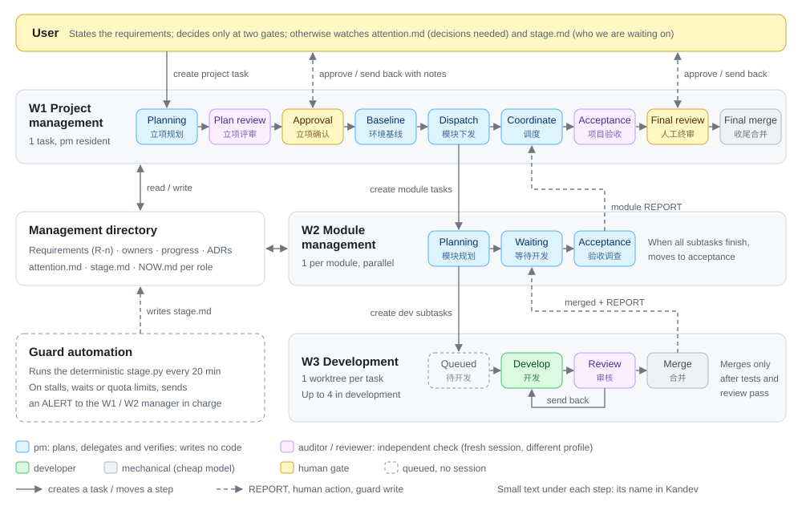

# Kandev Multi-Agent Development Architecture

[中文](README.md) | **English**

A workflow for [Kandev](https://github.com/kdlbs/kandev) that lets several coding agents split up and finish medium-to-large software projects, unattended or with light supervision. It consists of three Kandev workflows, a per-project management directory template, and deployment and guard scripts. Current version: v3.3.

> Chinese is the primary language of this repository. The English docs cover the human-facing parts; the prompts the agents receive, the agent entry point [AGENTS.md](AGENTS.md), the role cards and templates, and the research reports are in Chinese. The Kandev workflow and step names are Chinese too, so the English docs give each step's Chinese name next to its English one.

## Introduction

While building software with Kandev, I wanted a multi-agent development process that is **more efficient, more reliable, and able to run unattended for long stretches**. People only state requirements and make a decision at a few key points. Breaking down work, coding, review, merging and acceptance are all done by agents. When something goes wrong, the system notices and recovers on its own, and when it does need a person, it says exactly what it needs.

I designed this workflow together with Claude after studying the projects and practices below, then refined it over several trial runs on real projects:

| Reference | What we took from it |
|---|---|
| [Kandev](https://github.com/kdlbs/kandev) | The platform: per-step agent profiles, completion signals, subtasks and `blocked_by`, messages between tasks, one worktree per task |
| [deepseek-ai/dsh-superagent-prototype](https://github.com/deepseek-ai/dsh-superagent-prototype) | Constraints that code can enforce are not left to prompts alone; "who are we waiting on" is derived from facts; the verbatim requirements are carried through to the end; delivery conclusions are honest |
| [Anthropic: Building a C compiler with parallel Claudes](https://www.anthropic.com/engineering/building-c-compiler) | Tests are the judge (an external oracle); one writer per unit of work |
| [Anthropic: Harness design for long-running apps](https://www.anthropic.com/engineering/harness-design-long-running-apps) | Separate planner / generator / evaluator; an independent, skeptical evaluator |
| [Cursor: Scaling agents](https://cursor.com/blog/scaling-agents) | Planner / Worker / Judge layers; throughput without a CI gate cannot be verified |
| [OpenAI: Harness engineering](https://openai.com/index/harness-engineering/) | A short AGENTS.md as a map; state and knowledge live in structured docs |
| [Cognition: Multi-agents working](https://cognition.com/blog/multi-agents-working) | Single writer, many contributors; the reviewer sees only the deliverable, not the coder's context |
| [MAST: Why do multi-agent LLM systems fail?](https://arxiv.org/abs/2503.13657) | Most failures come from unclear specs and termination conditions and from missing verification, so every loop has a cap and every task has a decidable done condition |
| [Gas Town](https://gastown.dev/docs/intro) | Role split (break down, execute, monitor, merge) and a resident monitor |
| [Claude Code dynamic workflows](https://code.claude.com/docs/en/workflows.md) and other orchestration platforms | Platform comparison: we stay on Kandev for now |

The full research and comparisons are in [reports/](reports/) and [research_notes/](research_notes/) (Chinese).

## Core design

- **Three layers, split along knowledge boundaries**: project management (1 task; holds only the requirements, the module list and module boundaries, and the project acceptance criteria) → module management (1 task per module, in parallel; holds only its own spec, interfaces and tasks) → development (1 isolated worktree per task; needs only a self-contained contract). Managers only plan and delegate and never write code; the environment and skeleton are built by the baseline module, which runs first, through development tasks.
- **Independent verifiers**: plan review, module acceptance, project acceptance and review all switch profile and open a fresh session, apply the criteria written by the level above, and write failures as fix items that can be dispatched as is; long-running sessions only route.
- **Tests are the judge**: every development task has a machine-checkable done condition. Review uses a different profile in a fresh session, reruns the tests as-is, and writes down the evidence it personally checked for each acceptance criterion.
- **State lives in files; sessions are disposable**: each project has a management directory (requirements, ownership registry, progress, decision records). After any session reset, work resumes by following the recovery protocol.
- **Verbatim requirements all the way through**: each user requirement is numbered R-n, and both planning and acceptance check against them one by one, so nothing drifts in paraphrase.
- **People watch only two files**: `project/attention.md` (decisions you need to make, each with a recommended answer) and `agents/guard/stage.md` (who the system is waiting on right now).
- **Guard**: one Kandev automation per workspace runs the deterministic `stage.py` every 20 minutes. It detects stalls, waits and usage limits, and notifies the right manager.

## Architecture



(The diagram shows v3.1; the step tables in [docs/workflow.en.md](docs/workflow.en.md) are authoritative: v3.2 removed the Environment baseline step, whose work is now done by the baseline module.) Yellow steps are human gates. Plan approval (立项确认) only stops in attended or plan_only mode, while final human review (人工终审) always needs a person's approval. What each step does, how tasks move, and how sessions are managed: [docs/workflow.en.md](docs/workflow.en.md). More detailed diagrams, including which agent interactions are allowed: [docs/workflow-diagrams.en.md](docs/workflow-diagrams.en.md).

## Usage

### Prerequisites

- Kandev running on your machine with its external MCP available (default `http://localhost:38429/mcp`).
- Python 3 (the scripts use only the standard library).
- Five required agent profiles:
  - `pm`, and `auditor` (different from pm)
  - `developer`, and `reviewer` (different from developer, ideally from another vendor)
  - `mechanical` (runs the merge gate; a coding model)
- Optional: `plan_auditor` (plan review, the strongest model; defaults to auditor), `module` (defaults to pm), `module_auditor` (different from module; defaults to auditor), `intake` (the Intake entry step; a light model is enough; defaults to mechanical)

### Option 1: hand it to an agent (recommended)

Copy one of the prompts below to an agent that can access your local files and the Kandev MCP, such as Claude Code, Codex, or a task agent inside Kandev. The agent's entry point is [AGENTS.md](AGENTS.md) (Chinese; agents read it fine). It has the steps for deploying, verifying, starting a project, running the benchmark and changing the workflow, and says where the agent must ask you first.

**Deploy and verify**

```text
Clone https://github.com/Koha9/kandev-multiagent-architecture to this machine (reuse the existing directory if it is already cloned),
then follow sections A and B of AGENTS.md in the repo root to deploy this multi-agent workflow to my local Kandev and verify it.
- Kandev external MCP: http://localhost:38429/mcp
- Workspace: <workspace name; if unsure, list them and let me choose>
Ask me before choosing profiles, before changing Kandev, and before any check that starts a session. Finish with a table of every check's result.
```

**Start a project**

```text
Following section C of <local path of this repo>/AGENTS.md, start a new project in Kandev with the multi-agent workflow:
- Repository: <absolute local path>, base branch: <main>
- Mode: attended (wait for me at key points)
- Requirements, most important first:
  1. <requirement 1>
  2. <requirement 2>
Show me the [TASK v1] task description first; create and start the task only after I confirm.
```

**Run the benchmark to check a deployment**

```text
Following section D of <local path of this repo>/AGENTS.md, run the benchmark project once. When it finishes, append the metrics to evaluation/bench/results.md,
and tell me the total duration, how many times review sent work back, how many guard alerts fired, and the requirement coverage. Before starting, tell me the expected cost and duration.
```

### Option 2: deploy by hand

1. Follow [kandev/README.en.md](kandev/README.en.md): fill in `kandev/profiles.local.json`, then run `check_docs.py`, `build_workflows.py apply` and `verify_export.py`.
2. Create the guard automation following [kandev/handoff/guard-automation.md](kandev/handoff/guard-automation.md) (Chinese).
3. Create a task in `多Agent · 项目管理` (the W1 project management workflow), select the repository, write your requirements in the description, then click Start task. The task starts in the Intake step (「接收」): it derives the repository, branch, management directory and similar parameters, asks you for the rest (run mode, whether to stop after planning, ...), then hands over to the pm. To skip the questions, write the complete description using the `[TASK v1]` template from the "Deployment and launch" section of [docs/workflow.en.md](docs/workflow.en.md); parameters and defaults are described in [docs/intake.md](docs/intake.md) (Chinese).

To see what the workflows look like first: [kandev/export/](kandev/export/README.en.md) has the three workflows exported from a real deployment.

### Where to look while it runs

- The Kandev board: which step each task is in.
- `<mgmt_root>/project/attention.md`: decisions you need to make.
- `<mgmt_root>/agents/guard/stage.md`: who the system is waiting on.
- Plan approval (立项确认) and final human review (人工终审): drag the task to the next step to approve; send a message in the task to send it back with notes.

## Documentation map

| Topic | Where |
|---|---|
| Overall design: roles, steps, gates, concurrency, known limitations, rejected designs | [docs/workflow.en.md](docs/workflow.en.md) |
| Diagrams | [docs/workflow-diagrams.en.md](docs/workflow-diagrams.en.md) (diagrams show v3.1; the step tables in workflow.en.md are authoritative) |
| Full prompt and configuration of every step | [docs/prompts.md](docs/prompts.md) (Chinese, generated by `kandev/build_workflows.py`) |
| Structure of the management directory and its doc formats | [docs/mgmt-workspace.en.md](docs/mgmt-workspace.en.md) |
| How agents message each other | [mgmt-template/protocol/message.md](mgmt-template/protocol/message.md) (Chinese) |
| Conventions for the project being built: quota, side effects, constraint list, tests, screenshots, merging and pushing | [docs/project-conventions.en.md](docs/project-conventions.en.md) |
| Templates, role cards and check scripts copied into every project | [mgmt-template/](docs/mgmt-template.en.md) |
| Deployment scripts | [kandev/README.en.md](kandev/README.en.md) |
| Example workflows (Kandev export) | [kandev/export/](kandev/export/README.en.md) |
| Benchmark project and metrics collection | [evaluation/](evaluation/README.en.md) |
| Research: success stories, saving tokens, Kandev mechanics, GitHub as a collaboration platform | [reports/多Agent协作与Kandev工作流调研.md](reports/多Agent协作与Kandev工作流调研.md) (Chinese) |
| Comparison with dsh-superagent | [reports/借鉴-dsh-superagent.md](reports/借鉴-dsh-superagent.md) (Chinese) |
| Platform choice: should we replace Kandev? | [reports/平台选型-是否替换Kandev.md](reports/平台选型-是否替换Kandev.md) (Chinese) |
| Early design drafts | [docs/history/](docs/history/) (Chinese) |

## Repository layout

```
├─ AGENTS.md         Entry point for agents: deploy, verify, start a project, run the benchmark, change the workflow
├─ docs/             Architecture docs, diagrams, generated prompts, management directory and project conventions
├─ kandev/           Deployment scripts, guard script, example workflows (export/), handoff prompts
├─ mgmt-template/    Per-project management directory template: role cards, message protocol, check scripts
├─ evaluation/       Benchmark project and metrics collection
├─ reports/          Research reports
└─ research_notes/   Research notes
```
