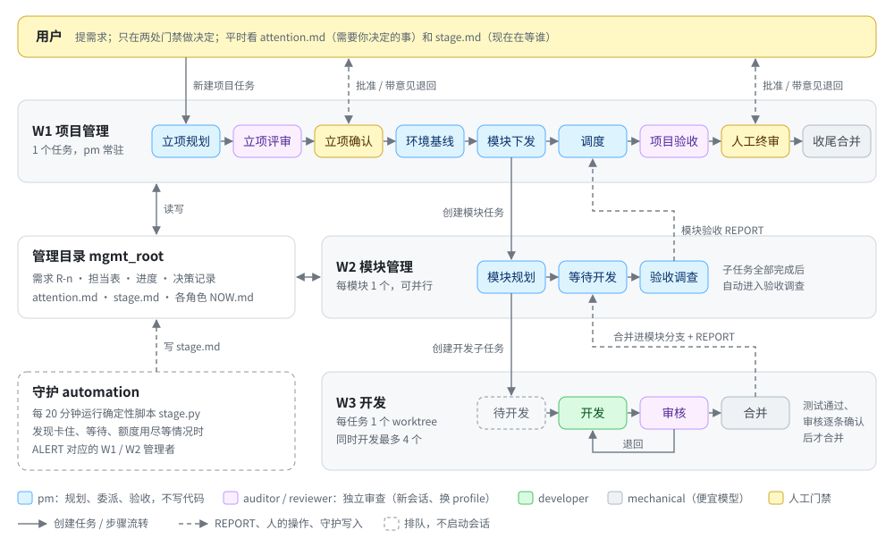

# Kandev 多 Agent 开发架构

在 [Kandev](https://github.com/kdlbs/kandev) 上让多个编码 agent 分工协作、无人值守或半值守地完成中到大型软件项目的一套 workflow：三套 Kandev workflow、项目管理目录模板、部署与守护脚本。当前版本 v3.1。

## 简介

用 Kandev 做开发时，我希望有一套**更高效、更可靠、能长时间无人值守运行**的多 agent 开发流程：人只负责提需求，并在少数几个关键节点做决定；拆解、开发、审核、合并、验收都交给 agent，出了问题能自己发现、自己恢复，需要人的时候也能说清楚要人做什么。

这套 workflow 是我和 Claude 一起调研了下面这些项目和实践之后设计出来的，又经过实际项目的试跑和多轮改进：

| 参考 | 借鉴了什么 |
|---|---|
| [Kandev](https://github.com/kdlbs/kandev) | 运行平台：按步骤绑定 agent profile、完成信号、子任务与 `blocked_by`、任务间消息、每任务一个 worktree |
| [deepseek-ai/dsh-superagent-prototype](https://github.com/deepseek-ai/dsh-superagent-prototype) | 能用代码强制的约束不只写在 prompt 里；"在等谁"由事实推导；需求原文贯穿到底；交付结论如实 |
| [Anthropic：用并行 Claude 写 C 编译器](https://www.anthropic.com/engineering/building-c-compiler) | 测试是裁判（外部 oracle）；一个工作单元只有一个写者 |
| [Anthropic：长时运行应用的 harness 设计](https://www.anthropic.com/engineering/harness-design-long-running-apps) | planner / generator / evaluator 分离；独立且"多疑"的评审者 |
| [Cursor：Scaling agents](https://cursor.com/blog/scaling-agents) | Planner / Worker / Judge 分层；没有 CI 门禁的吞吐量无法验证 |
| [OpenAI：Harness engineering](https://openai.com/index/harness-engineering/) | 短小的 AGENTS.md 作为地图，状态和知识放进结构化文档 |
| [Cognition：Multi-agents working](https://cognition.com/blog/multi-agents-working) | 单写者、多贡献者；评审者只看交付物，不继承编码者的上下文 |
| [MAST：多 agent 系统为什么失败](https://arxiv.org/abs/2503.13657) | 失败多来自规格与终止条件不清、验证缺失，所以每个循环都有上限、每个任务都有可判定的完成条件 |
| [Gas Town](https://gastown.dev/docs/intro) | 角色分工（拆任务、执行、监控、合并）与常驻监控者 |
| [Claude Code 动态工作流](https://code.claude.com/docs/en/workflows.md) 等编排平台 | 平台选型对比：目前不换平台，继续用 Kandev |

完整的调研和对比在 [reports/](reports/) 和 [research_notes/](research_notes/)。

## 核心设计

- **三层分工**：项目管理（1 个）→ 模块管理（每模块 1 个，可并行）→ 开发（每任务 1 个独立 worktree）。管理者只规划、委派、验收，不写代码。
- **测试是裁判**：每个开发任务都有机器可判定的完成条件；审核换一个 profile、开新会话，原样重跑测试，每条验收标准写出亲自确认的证据。
- **状态存文件，会话可抛弃**：每个项目有一个管理目录（需求、担当表、进度、决策记录），任何会话被重置后都能按恢复协议接着做。
- **需求原文贯穿到底**：用户需求逐条编号为 R-n，规划、验收都逐条对照，防止转述中走样。
- **人只看两处**：`project/attention.md`（需要你决定的事，每项附推荐答案）和 `agents/guard/stage.md`（系统现在在等谁）。
- **守护**：每个 workspace 一个 Kandev automation，每 20 分钟运行确定性的 `stage.py`，发现卡住、等待、用量上限等情况并通知对应的上级。

## 架构图



黄色步骤是需要人的门禁：「立项确认」只在 attended 或 plan_only 模式下停留，「人工终审」总是由人批准。每一步做什么、怎么流转、会话怎么管理，见 [docs/workflow.md](docs/workflow.md)；更详细的流程图（包括 agent 之间允许哪些交互）见 [docs/workflow-diagrams.md](docs/workflow-diagrams.md)。

## 怎么使用

### 准备

- 本机运行着 Kandev，外部 MCP 可用（默认 `http://localhost:38429/mcp`）。
- Python 3（脚本只用标准库）。
- 5 个 agent profile：`pm`、`auditor`（与 pm 不同）、`developer`、`reviewer`（与 developer 不同，最好换厂商）、`mechanical`（便宜模型即可）。

### 方式一：交给 agent（推荐）

把下面的 prompt 复制给一个能访问本机文件和 Kandev MCP 的 agent（例如 Claude Code、Codex，或 Kandev 里的任务 agent）。agent 的入口文档是 [AGENTS.md](AGENTS.md)，里面写了部署、验收、启动项目、跑基准、修改 workflow 的具体步骤和需要先问你的地方。

**部署并验收**

```text
请把 https://github.com/Koha9/kandev-multiagent-architecture 克隆到本机（已经克隆过就用现有目录），
然后按仓库根目录 AGENTS.md 的 A、B 两节，把这套多 Agent workflow 部署到我本机的 Kandev，并完成验收。
- Kandev 外部 MCP：http://localhost:38429/mcp
- workspace：<workspace 名称；不确定就列出来让我选>
选 profile、改动 Kandev、会启动会话的验证，都先问我。最后用一张表汇报每项验收结果。
```

**启动一个项目**

```text
按 <本仓库的本机路径>/AGENTS.md 的 C 节，在 Kandev 里用多 Agent workflow 启动一个新项目：
- 仓库：<本机绝对路径>，基线分支：<main>
- 模式：attended（关键节点等我确认）
- 需求（按重要度排序）：
  1. <需求 1>
  2. <需求 2>
先把 [TASK v1] 任务描述给我看，我确认后再创建并启动。
```

**跑基准项目，检验部署效果**

```text
按 <本仓库的本机路径>/AGENTS.md 的 D 节跑一次基准项目，结束后把指标追加到 evaluation/bench/results.md，
并告诉我总时长、审核退回次数、守护告警次数和需求覆盖情况。开始前先告诉我预计的费用和时长。
```

### 方式二：手动部署

1. 按 [kandev/README.md](kandev/README.md) 填写 `kandev/profiles.local.json`，运行 `check_docs.py`、`build_workflows.py apply`、`verify_export.py`。
2. 按 [kandev/handoff/guard-automation.md](kandev/handoff/guard-automation.md) 创建守护 automation。
3. 在「多Agent · 项目管理」新建任务，描述用 [docs/workflow.md](docs/workflow.md)「部署与启动」中的 `[TASK v1]` 模板，然后 Start task。

想先看看 workflow 长什么样：[kandev/export/](kandev/export/README.md) 是从实际部署导出的三套 workflow。

### 运行中看哪里

- Kandev 看板：每个任务在哪一步。
- `<mgmt_root>/project/attention.md`：需要你决定的事。
- `<mgmt_root>/agents/guard/stage.md`：现在在等谁。
- 「立项确认」「人工终审」：把任务拖到下一步表示批准；在任务里发消息表示带着意见退回。

## 文档地图

| 想了解 | 看哪里 |
|---|---|
| 整体设计：角色、步骤、门禁、并发、已知限制、已否决的设计 | [docs/workflow.md](docs/workflow.md) |
| 流程图 | [docs/workflow-diagrams.md](docs/workflow-diagrams.md)（也可以用浏览器打开 `docs/workflow-diagrams.html`） |
| 各步骤的完整 prompt 与配置 | [docs/prompts.md](docs/prompts.md)（由 `kandev/build_workflows.py` 生成） |
| 管理目录的构造与文档格式 | [docs/mgmt-workspace.md](docs/mgmt-workspace.md) |
| agent 之间怎么通信 | [mgmt-template/protocol/message.md](mgmt-template/protocol/message.md) |
| 被开发项目要遵守的约定：额度、副作用、约束清单、测试、截图、合并与推送 | [docs/project-conventions.md](docs/project-conventions.md) |
| 复制到每个项目的模板、角色卡和检查脚本 | [mgmt-template/](mgmt-template/README.md) |
| 部署脚本 | [kandev/README.md](kandev/README.md) |
| 示例 workflow（Kandev 导出） | [kandev/export/](kandev/export/README.md) |
| 基准项目与指标采集 | [evaluation/](evaluation/README.md) |
| 调研：成功案例、省 token、Kandev 机制、GitHub 作为协作平台 | [reports/多Agent协作与Kandev工作流调研.md](reports/多Agent协作与Kandev工作流调研.md) |
| 与 dsh-superagent 的对比 | [reports/借鉴-dsh-superagent.md](reports/借鉴-dsh-superagent.md) |
| 平台选型：要不要换掉 Kandev | [reports/平台选型-是否替换Kandev.md](reports/平台选型-是否替换Kandev.md) |
| 早期设计稿 | [docs/history/](docs/history/) |

## 目录结构

```
├─ AGENTS.md         给 agent 的入口：部署、验收、启动项目、跑基准、修改 workflow
├─ docs/             架构文档、流程图、生成的 prompt、管理目录与项目约定
├─ kandev/           部署脚本、守护脚本、示例 workflow（export/）、交接 prompt
├─ mgmt-template/    每个项目的管理目录模板：角色卡、消息协议、检查脚本
├─ evaluation/       基准项目与指标采集
├─ reports/          调研报告
└─ research_notes/   调研笔记
```
