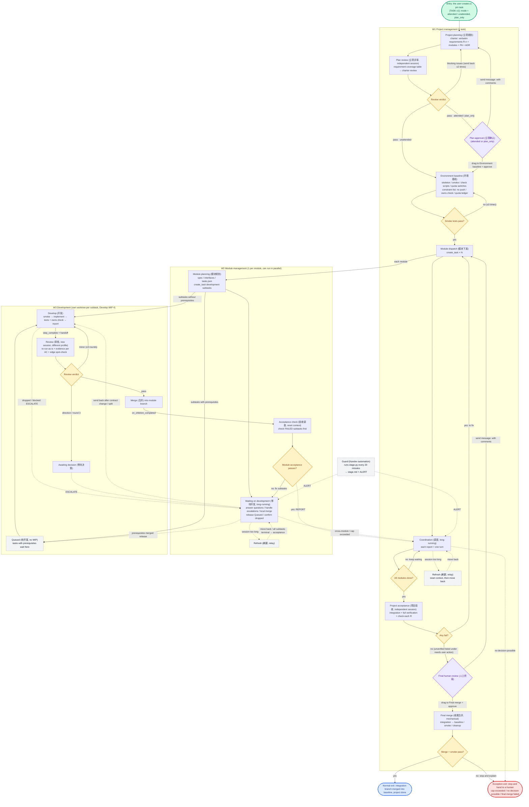
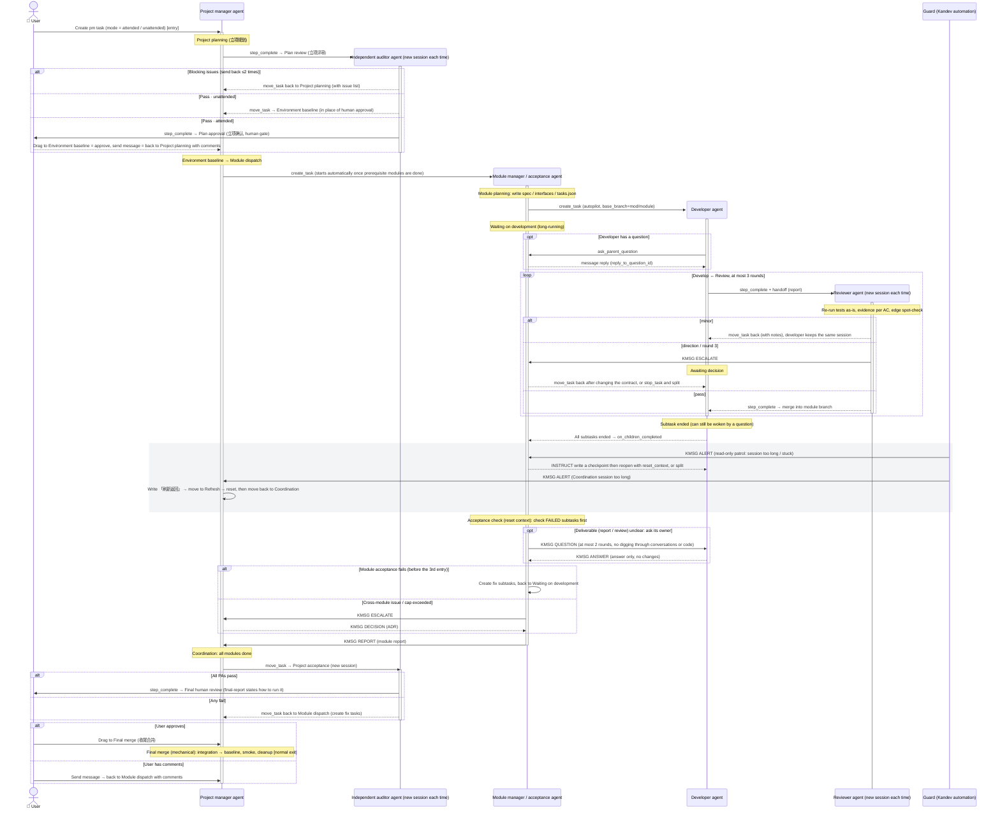

# Workflow v3.1 Diagrams

[中文](workflow-diagrams.md) | **English**

> Companion to [workflow.en.md](workflow.en.md). The diagrams are written in Mermaid and render directly in VS Code (Markdown Preview Mermaid extension), GitHub and Typora; you can also open `workflow-diagrams.html` in a browser.

---

## Diagram 1: Overall view (entries / loops / exits)

Legend: 🟩 entry　🟦 normal exit　🟥 exception exit　🟨 loop decision point　🟪 human gate　⬜ auxiliary (guard / refresh)　dashed line = message, notification or relay

### Entries

| Entry | Trigger | Where it lands |
|---|---|---|
| Project entry | The user creates a pm task (Start task; or leave it in Not started (「待立项」) and start it later by sending a message) | W1 Project planning (立项规划) |
| Module entry | The pm calls `create_task_kandev`; with dependencies, `blocked_by` unblocks it automatically once the prerequisite module is done | W2 Module planning (模块规划) |
| Subtask entry | The module agent calls `create_task_kandev` (autopilot, `base_branch=mod/<module>`); tasks with prerequisites are created in Queued (「待开发」) with `start_agent=false` | W3 Develop (开发) / Queued (待开发) |
| (Optional) external entry | GitHub Issue Watch imports issues as tasks | W1 or W2 |

### Loops

| # | Loop | Returns to | Ends when | Cap, and where it goes beyond the cap |
|---|---|---|---|---|
| L1 | Project planning ↔ Plan review | Project planning | Review passes | After 2 send-backs, the 3rd time only records non-blocking issues and passes |
| L2 | Plan approval (attended) | Project planning | The user approves | Up to the user |
| L3 | Environment baseline self-fix | Environment baseline | Smoke tests pass | 3 times → attended: hand to the user; unattended: write an ADR and stop |
| L4 | Develop ↔ Review | Develop (same session) | pass | Round 3 → Awaiting decision |
| L5 | Handling direction issues | Develop (contract changed) or a new subtask | The module agent decides | Cross-module → pm |
| L6 | Module acceptance ↔ fix subtasks | Waiting on development | Module acceptance passes | 3rd time → escalate to pm |
| L7 | Coordination wait | Coordination (one turn per report) | All modules done | Session too long → Refresh |
| L8 | Project acceptance / final-review comments ↔ fixes | Module dispatch | The user approves | Up to the user |
| L9 | Session refresh | Refresh step → original step | State written to NOW | Still too long after refresh → split the task or module |

### Exits

| Exit | Condition | Result |
|---|---|---|
| Normal exit | In Final human review the user drags the task to Final merge (「收尾合并」), and both the merge and the smoke tests pass | Integration branch merged into baseline, temporary resources cleaned up, task done |
| Subtask exit | Review passes and it is merged into the module branch | Subtask ends; when all have ended, `on_children_completed` fires |
| Module exit | Module acceptance passes and has been reported | Module task ends; modules depending on it are unblocked |
| Exception exit | Loop cap exceeded, management cannot decide, conflict or smoke failure during Final merge | Stops at the current step with an explanation, waiting for a human |
| Abandoned exit | Task too large or in the wrong direction, stopped with `stop_task_kandev` | Marked `failed` in `tasks.json`, replaced by new subtasks split from it |

---

## Diagram 2: Agent view (lifecycle + allowed interactions)

Shown as a sequence diagram: each column is an agent. **Vertical activation bar = the lifetime of that agent's session (lifecycle)**; arrows = **allowed** interactions (labeled with the tool used). Any interaction not drawn in the diagram is not allowed.
`loop` means a loop, `alt` a branch, `opt` an optional part; the gray block is what the guard may trigger at any time.

### Agent lifecycles at a glance

| Agent | Created by | Session lifetime | When the session is reopened | When it ends |
|---|---|---|---|---|
| Project manager | The user | Long-lived (whole project) | Reset via the Refresh (「刷新」) step | Final merge completes |
| Independent auditor | The workflow (Plan review / Project acceptance) | One review | A new session every time | Gives a verdict |
| Module manager / acceptance | Project manager | For the life of the module | Reset via the Refresh step; reset on entering Acceptance check | Module report completed |
| Developer | Module manager | One subtask | Reopened after writing a checkpoint when alerted | Merged into the module branch, or stopped and split |
| Reviewer | The workflow (Review step) | One review | A new session every time | Gives a verdict |
| Guard | Kandev automation (cron) | One patrol | A new session every time | Sends alerts, or ends with nothing to do |

### Interaction permission matrix

Rows = initiator, columns = receiver. ✅ allowed　⚠️ allowed with conditions　❌ forbidden

| Initiator ↓ / Receiver → | User | Project manager | Module manager | Developer | Reviewer |
|---|---|---|---|---|---|
| **Project manager** | ⚠️ attended only: questions, gates | — | ✅ create tasks, decisions | ❌ | ❌ |
| **Independent auditor** | ✅ via gate steps | ✅ only through `move_task` (with comments) and task docs | ❌ | ❌ | ❌ |
| **Module manager** | ❌ via the project manager | ✅ reports, escalations | ⚠️ other modules: factual questions only | ✅ create tasks, reply, send back, stop, ask | ⚠️ read the review deliverable; if unclear, ask that review session |
| **Developer** | ❌ (under autopilot can only ask the upstream manager) | ❌ | ✅ `ask_parent_question` | ❌ no direct communication between developers | ✅ only through `step_complete` + handoff |
| **Reviewer** | ❌ | ❌ | ✅ ESCALATE | ✅ only by sending back via `move_task` (with notes) | — |
| **Guard** | ❌ | ✅ ALERT; move to Refresh when the pm is stuck and unresponsive | ✅ ALERT | ❌ relayed via the module manager | ❌ |

### Explicitly forbidden interactions (and why)

- **Developer ↔ developer**: parallel writers coordinate privately, resulting in duplicated work or overwriting each other. When coordination is needed, it goes through the module manager.
- **Reviewer / independent auditor ↔ conversation with the reviewee**: it would break the reviewer's clean context. Reviews express opinions only through structured verdicts and send-back notes.
- **Developer / reviewer → project manager**: skipping a level bloats the project manager's context. Everything is aggregated through the module manager.
- **Modules agreeing on interfaces privately**: cross-module decisions must be written as ADRs and decided by the project manager.
- **The guard fixing things directly**: the guard only detects and alerts; fixes are carried out by the task's upstream manager. The only exception is moving a stuck pm to Refresh.
- **Looking things up on someone else's behalf**: for information you don't own, ask the owner directly instead of digging through conversation history or reading code to guess. When asked about something you don't own, refer the asker to the owner.
- **Chatting in GitHub comments**: GitHub only records summaries of state changes; communication between agents stays inside Kandev.
