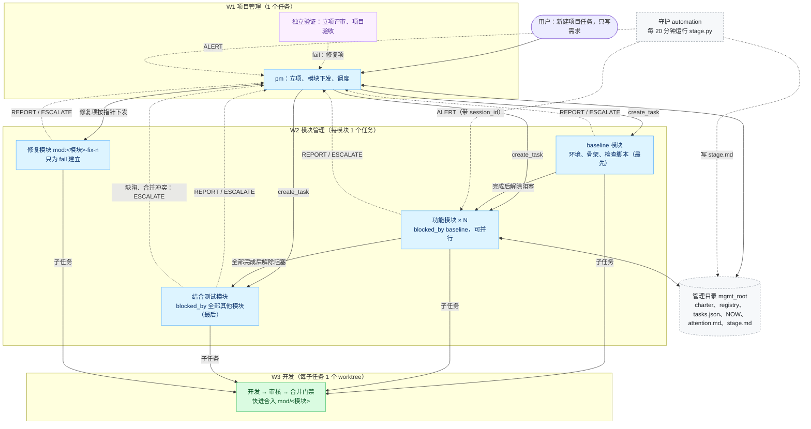
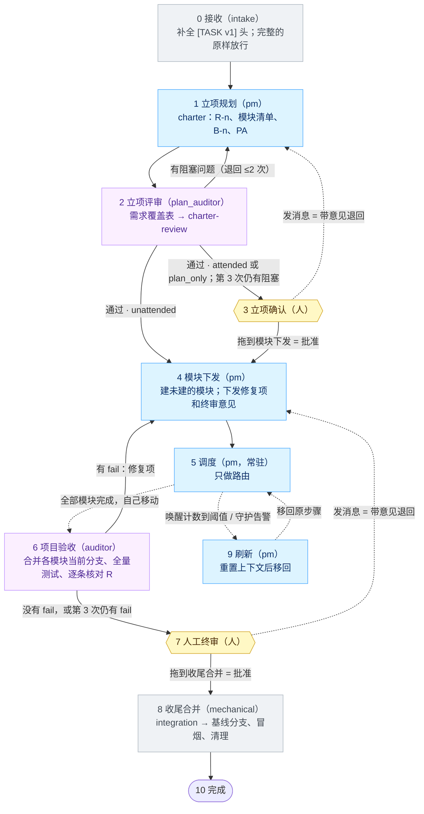
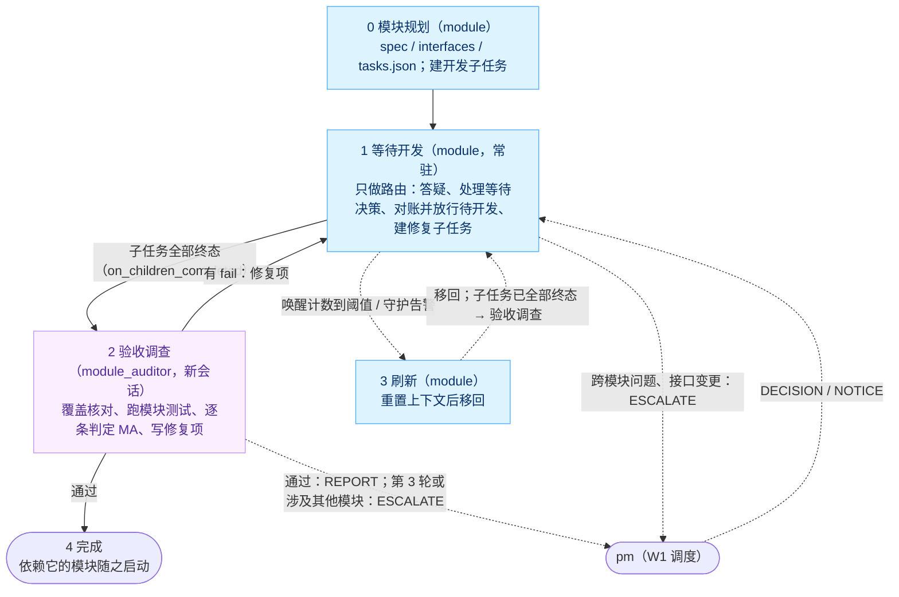
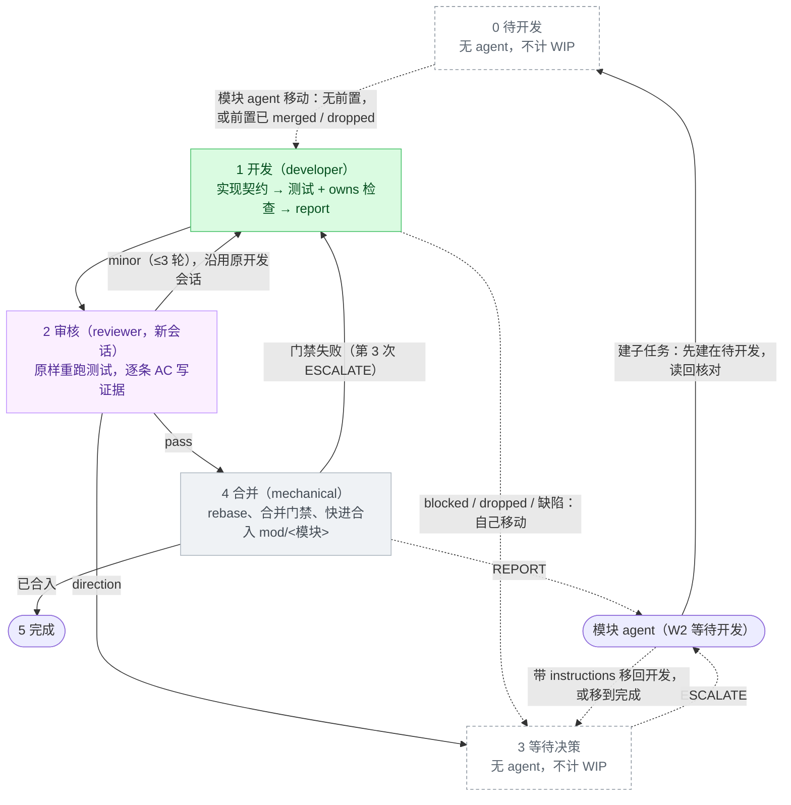
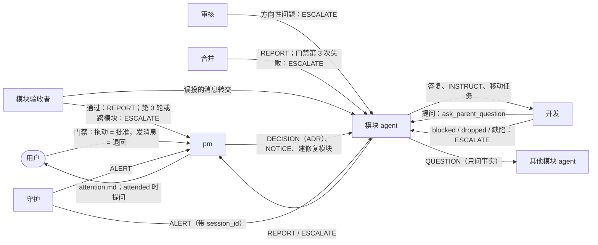

# Workflow 流程图

> 配套 [workflow.md](workflow.md)，步骤和流转以它第 4–6 节的表格为准。图用 Mermaid 编写，GitHub、VS Code（Markdown Preview Mermaid 插件）、Typora 都能直接渲染。
> 颜色：蓝 = 管理者（pm / module），紫 = 独立的验证者（每次新会话、换 profile），绿 = 开发，灰 = intake / mechanical，黄 = 人工门禁，虚线框 = 没有 agent 的步骤。虚线箭头 = 消息或由 agent 自己移动。

## 图 1：整体结构

分支：`基线分支 ← 收尾合并 ← integration ← mod/<模块> ← 开发 worktree 分支`，`mod/baseline` 从基线分支切出，其他模块分支从 `mod/baseline`（或所依赖的模块分支）切出。详见 workflow.md 第 9 节。

## 图 2：W1 项目管理

## 图 3：W2 模块管理

baseline 模块（`kind: baseline`）和结合测试模块（`kind: integration`）走同样的步骤，内容上的差别见 workflow.md 第 5 节。结合测试任务报告的缺陷不在本模块修：ESCALATE 给 pm，由担当模块的修复模块修完后再重跑。

## 图 4：W3 开发

## 图 5：消息与升级路径

图中没有画出的通信一律不允许。消息格式见 [../mgmt-template/protocol/message.md](../mgmt-template/protocol/message.md)。

| 规则 | 理由 |
|---|---|
| 开发之间不直接通信 | 并行写者私下协调会造成重复工作或相互覆盖；任务之间的依赖只通过 `interfaces.md`，由模块 agent 协调 |
| 验证者不与被验证者对话 | 会破坏验证者干净的上下文；结论只通过任务文档、修复项和退回说明表达 |
| 开发、审核不越级找 pm | 一律经模块 agent 汇总，pm 的上下文不被任务细节填满 |
| 模块之间只问事实，不私下商定接口 | 变更接口只能经 pm（ESCALATE → DECISION + ADR） |
| 发给模块任务的消息带模块 agent 的 `session_id` | 不带时消息进任务的主会话，可能是验收者的 |
| 已完成（COMPLETED）的模块任务不发消息 | 只会排队；需要它再做事由 pm 建修复模块任务 |
| 守护只检测和告警，不修复 | 唯一的例外：把没有响应的 pm 移到「刷新」；用量上限重置后在原会话里继续 |
| 只有 pm 和「接收」能向用户提问 | 需要用户处理的事集中到 `project/attention.md` |
