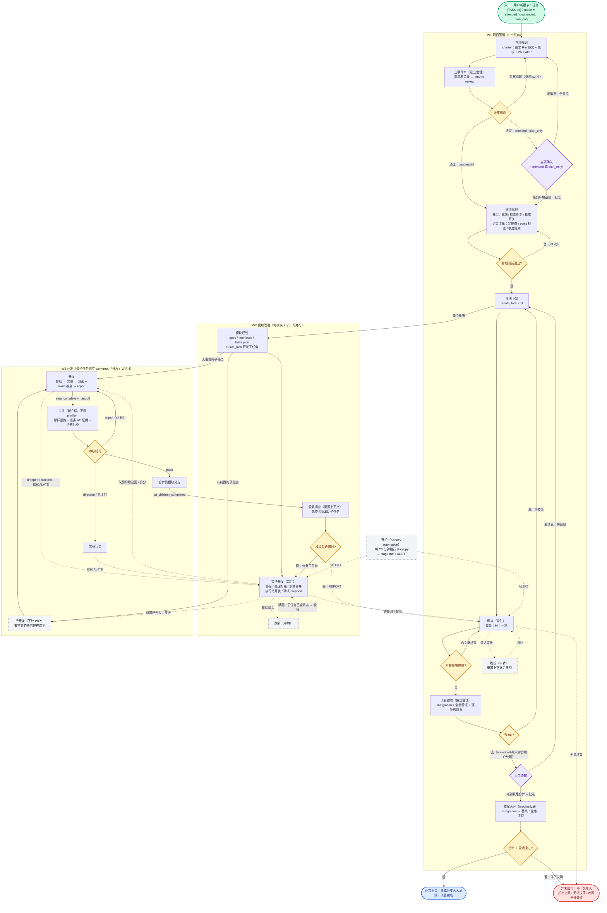
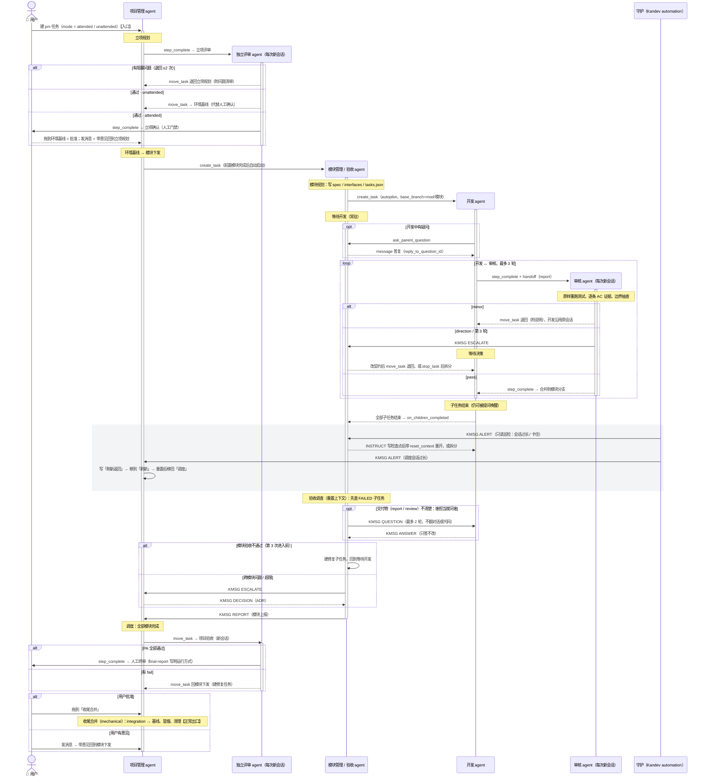

# Workflow v3.1 流程图

**中文** | [English](workflow-diagrams.en.md)

> 配套 [workflow.md](workflow.md)。图用 Mermaid 编写，可在 VS Code（Markdown Preview Mermaid 插件）、GitHub、Typora 中直接渲染，也可以用浏览器打开 `workflow-diagrams.html`。

---

## 图 1：整体视角（入口 / 循环 / 出口）

图例：🟩 入口　🟦 正常出口　🟥 异常出口　🟨 循环判定点　🟪 人工门禁　⬜ 辅助（守护 / 刷新）　虚线 = 消息、通知或中转

### 入口

| 入口 | 触发方式 | 进入位置 |
|---|---|---|
| 项目入口 | 用户新建 pm 任务（Start task；或放在「待立项」，之后发消息启动） | W1 立项规划 |
| 模块入口 | pm 调用 `create_task_kandev`；有依赖时，前置模块完成后由 `blocked_by` 自动解除阻塞 | W2 模块规划 |
| 子任务入口 | 模块 agent 调用 `create_task_kandev`（autopilot，`base_branch=mod/<模块>`）；有前置的以 `start_agent=false` 建到「待开发」 | W3 开发 / 待开发 |
| （可选）外部入口 | GitHub Issue Watch 把 issue 导入为任务 | W1 或 W2 |

### 循环

| # | 循环 | 回到哪里 | 结束条件 | 上限，超限后去向 |
|---|---|---|---|---|
| L1 | 立项规划 ↔ 立项评审 | 立项规划 | 评审通过 | 退回 2 次后，第 3 次只记录非阻塞问题并放行 |
| L2 | 立项确认（attended） | 立项规划 | 用户批准 | 由用户决定 |
| L3 | 环境基线自修 | 环境基线 | 冒烟测试通过 | 3 次 → attended 时交给用户，unattended 时写 ADR 并停下 |
| L4 | 开发 ↔ 审核 | 开发（沿用原会话） | pass | 第 3 轮 → 等待决策 |
| L5 | 方向性问题处理 | 开发（契约已改）或新子任务 | 模块 agent 做出决策 | 涉及跨模块 → pm |
| L6 | 模块验收 ↔ 修复子任务 | 等待开发 | 模块验收通过 | 第 3 次 → 升级给 pm |
| L7 | 调度等待 | 调度（每条上报一轮） | 全部模块完成 | 会话过长 → 刷新 |
| L8 | 项目验收 / 终审意见 ↔ 修复 | 模块下发 | 用户批准 | 由用户决定 |
| L9 | 会话刷新 | 刷新步骤 → 原步骤 | 状态已写入 NOW | 刷新后仍过长 → 拆分任务或模块 |

### 出口

| 出口 | 条件 | 结果 |
|---|---|---|
| 正常出口 | 用户在人工终审中把任务拖到「收尾合并」，且合并与冒烟测试都通过 | 集成分支合入基线，临时资源已清理，任务完成 |
| 子任务出口 | 审核通过并合入模块分支 | 子任务结束；全部结束时触发 `on_children_completed` |
| 模块出口 | 模块验收通过并已上报 | 模块任务结束；依赖它的模块解除阻塞 |
| 异常出口 | 超出循环上限、管理层无法决策、收尾合并时冲突或冒烟失败 | 停在当前步骤并说明原因，等人处理 |
| 废弃出口 | 任务过大或方向错误，被 `stop_task_kandev` 停止 | `tasks.json` 中标记 `failed`，由拆分出的新子任务替代 |

---

## 图 2：Agent 视角（lifecycle + 允许的交互）

用时序图表示：每一列是一个 agent。**竖向激活条 = 该 agent 的会话存续期（lifecycle）**；箭头 = **允许的**交互（标注所用工具）。图中没有画出的交互一律不允许。
`loop` 表示循环，`alt` 表示分支，`opt` 表示可选，灰色区块是守护随时可能触发的部分。

### Agent lifecycle 一览

| Agent | 由谁创建 | 会话寿命 | 何时重开会话 | 何时结束 |
|---|---|---|---|---|
| 项目管理 | 用户 | 长期（整个项目） | 经「刷新」步骤重置 | 收尾合并完成 |
| 独立评审 | workflow（立项评审 / 项目验收） | 一次评审 | 每次都是新会话 | 给出结论 |
| 模块管理 / 验收 | 项目管理 | 模块存续期间 | 经「刷新」步骤重置；进入验收调查时重置 | 模块上报完成 |
| 开发 | 模块管理 | 一个子任务 | 被告警时写检查点后重开 | 合入模块分支，或被 stop 后拆分 |
| 审核 | workflow（审核步骤） | 一次审核 | 每次都是新会话 | 给出结论 |
| 守护 | Kandev automation（cron） | 一次巡检 | 每次都是新会话 | 发出告警，或无事结束 |

### 交互权限矩阵

行 = 发起方，列 = 接收方。✅ 允许　⚠️ 有条件允许　❌ 禁止

| 发起 ↓ / 接收 → | 用户 | 项目管理 | 模块管理 | 开发 | 审核 |
|---|---|---|---|---|---|
| **项目管理** | ⚠️ 仅 attended：提问、门禁 | — | ✅ 建任务、决策 | ❌ | ❌ |
| **独立评审** | ✅ 经门禁步骤 | ✅ 只通过 `move_task`（附意见）和任务文档 | ❌ | ❌ | ❌ |
| **模块管理** | ❌ 经项目管理 | ✅ 上报、升级 | ⚠️ 其他模块：只问事实 | ✅ 建任务、答复、退回、停止、提问 | ⚠️ 读交付物 review；有疑问就问该次审核会话 |
| **开发** | ❌（autopilot 下只能问上级） | ❌ | ✅ `ask_parent_question` | ❌ 开发之间禁止直接通信 | ✅ 只通过 `step_complete` + handoff |
| **审核** | ❌ | ❌ | ✅ ESCALATE | ✅ 只通过 `move_task` 退回（附说明） | — |
| **守护** | ❌ | ✅ ALERT；pm 卡住且无反应时移到「刷新」 | ✅ ALERT | ❌ 经模块管理转达 | ❌ |

### 明确禁止的交互（及理由）

- **开发 ↔ 开发**：并行写者之间会私下协调，结果是重复工作或相互覆盖。需要协调时，经模块管理处理。
- **审核 / 独立评审 ↔ 被评审者对话**：会破坏评审者干净的上下文。评审只能通过结构化结论和退回说明表达意见。
- **开发 / 审核 → 项目管理**：越级上报会让项目管理的上下文膨胀。一律经模块管理汇总。
- **模块之间私下商定接口**：跨模块决策必须写成 ADR，由项目管理拍板。
- **守护直接修复**：守护只做检测和告警，修复由该任务的上级执行。唯一例外是把卡住的 pm 移到「刷新」。
- **替别人查询**：不归你担当的信息，直接问担当者，不要自己翻对话记录或读代码推测。被问到不归自己的事时，转介给担当者。
- **在 GitHub 评论里闲聊**：GitHub 只记录状态变化的摘要，agent 之间的交流留在 Kandev 内部。
